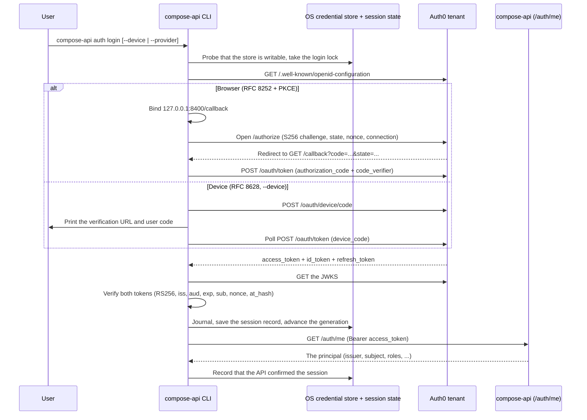

# CLI sign-in compared with VCell's

How VCell's Python client signs in (its `auth_utils.py`) and how the compose-api CLI does. It records why the CLI
does more than VCell's helper; how to use the CLI is in [cli.md](cli.md), and the plan behind it in
[plan-cli.md](plan-cli.md). Module paths below are relative to `clients/python/compose_api_client/`.

| Feature | VCell `auth_utils.py` | compose-api CLI |
|:---|:---|:---|
| **Shape** | A library function, `login_interactive()`, that returns an `ApiClient`. | CLI commands: `auth login`, `auth signup`, `auth status`, `auth logout`. |
| **OAuth library** | `requests_oauth2client` handles all protocol work. | Authlib supplies only protocol pieces (the login URL, PKCE, ID-token rules); httpx and PyJWT do the rest (`auth/oauth.py`). |
| **Sign-in methods** | Browser only. | Browser; device code (`--device`) for SSH or machines without a browser; `--no-browser` to print the link instead. |
| **PKCE, state, nonce** | Yes, by default in `requests_oauth2client`; `validate_callback` checks the state. | Yes, explicitly: S256 challenge, constant-time state comparison, nonce, and the `iss` callback parameter (RFC 9207). |
| **Audience parameter** | Not sent. | Sent as the profile's `auth0_audience` (for example `https://api.compose.cam.uchc.edu`). |
| **Token sent to the API** | The ID token. | The access token (`ext/session.py`). |
| **Token checks** | `validate=False`, so the ID token is never checked. | Both tokens fully checked before anything is saved: RS256 only, keys from the tenant's JWKS, issuer, audience, required claims, `nonce` / `azp` / `at_hash`, and the same user in both tokens (`auth/oauth.py`). |
| **Callback server** | `http.server`; handles one request; no timeout; a port chosen from 15 registered ports (51111–65111). | An `asyncio` listener bound to `127.0.0.1` only, on one registered port (8400); times out; refuses malformed or stray requests without ending the sign-in (`auth/callback.py`). |
| **Saved login** | None; every Python session signs in again. | The OS credential store through `keyring` (macOS Keychain, Secret Service, Windows Credential Manager), never a plaintext file (`auth/storage.py`). On Windows the CLI writes its item itself, as UTF-8, which is how a session fits Credential Manager's 2560-byte limit (`auth/windows_state.py`). |
| **Refresh token** | Requests `offline_access`, then discards the refresh token. | Stored and used before the access token expires, with rotation handled (`auth/session.py`). |
| **HTTP 401** | No recovery; the request fails. | Renews once and replays a read; never resends a submission (`ext/session.py`). |
| **Logout** | None. | Revokes the refresh token at Auth0 and deletes the local copy (`auth/session.py`). |
| **Configuration** | Defaults hardcoded in the function signature. | Named profiles (`profiles.py`); the issuer is derived from `auth0_domain`. |

## How the CLI signs in

The CLI is a public native OAuth 2.0 / OpenID Connect client (`Auth0OAuthClient` in `auth/oauth.py`: no client
secret, `token_endpoint_auth_method=none`).

1. **Authorization code with S256 PKCE and a loopback redirect** (RFC 8252, RFC 7636), the default (`auth/browser.py`,
   `auth/callback.py`):
   - each attempt generates its own `state`, `nonce` and code verifier;
   - the listener binds `127.0.0.1:<callback_port>/callback` *before* the browser opens;
   - `--provider email|google` picks the Auth0 connection, `auth signup` adds `screen_hint=signup` and
     `prompt=login`, and `--no-browser` prints the link instead of opening it;
   - the callback's `Host`, `state` and optional `iss` are checked before the code is exchanged with its verifier.
2. **Device authorization grant** (RFC 8628, `--device`, `auth/device.py`): the verification page must be on the
   tenant's own host; polling follows the server's interval, adds 5 s on `slow_down`, and backs off on transient
   failures.
3. **Refresh and revocation** (RFC 6749, RFC 7009): a stored session asks for `offline_access`. It renews the access
   token within 60 s of expiry, or once after a 401 on a read. `auth logout` revokes the refresh token unless
   `--local-only` is given, then erases the local session.
4. **One command (`--ephemeral-auth`)**: a root option for any API command. It asks for no `offline_access`, keeps
   the grant in memory for that command, and discards it on exit.

## What the CLI adds underneath

- **Verification before storage** (`auth/oauth.py`): the CLI fetches the tenant's JWKS and verifies the access token
  (RS256, `iss`, `aud` equal to the profile's audience, `exp`, `iat`, `sub`) and the ID token (`aud` equal to the
  client ID, `nonce`, `azp`, `at_hash`, and the same `sub`) before it builds a grant.
- **Sessions bound to a profile** (`profiles.py`): settings come from `COMPOSE_API_CLI_*` variables, then
  `config.toml`, then the built-in `production` and `local` profiles. A session is stored under a digest of issuer,
  client ID, audience, API origin and scopes, so changing any of them selects a different, empty session and a token
  never reaches an origin or audience it was not obtained for.
- **Secrets apart from state** (`auth/storage.py`, `auth/state.py`, `auth/session.py`): the whole session record is
  one entry in the OS credential store, and only the macOS, Secret Service and Windows backends are accepted, with no
  file fallback. Non-secret state (a generation number and a refresh journal) and the lock files live in a private
  state directory. A refresh journals first, so a refresh interrupted after its request was sent invalidates the
  session rather than replaying a refresh token that may already be spent.
- **API confirmation and a destination guard** (`ext/session.py`): after saving, `auth login` calls `GET /auth/me`
  and checks that the API names the same issuer and subject. Every API request passes a hook that refuses, before
  anything is sent, a scheme, host or port other than the profile's API, any user info, or a path outside the
  bundled OpenAPI spec.
