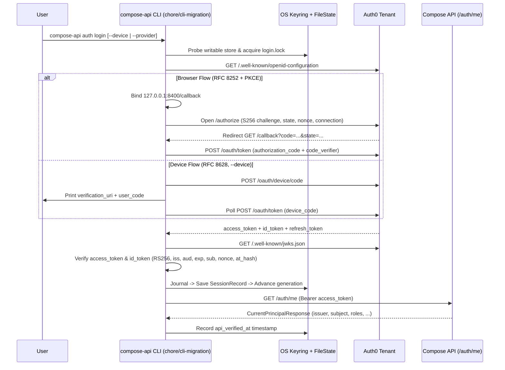

# Compose API CLI: Authentication Comparison

Side-by-side comparison of `vcell/auth_utils.py` and `compose-api/compose_api/cli/auth/`.

| Feature | VCell — `auth_utils.py` | Compose API — `compose_api/cli/auth/` |
|:---|:---|:---|
| **Shape** | A library function, `login_interactive()`, that returns an `ApiClient`. | CLI commands: `auth login`, `auth signup`, `auth status`, `auth logout`. |
| **OAuth library** | `requests_oauth2client` handles all protocol work. | Authlib supplies only the protocol pieces (login URL, PKCE, ID-token rules); `httpx` and PyJWT handle the rest manually. |
| **Sign-in methods** | Browser only. | Browser; device code (`--device`) for SSH or machines without a browser; `--no-browser` to print the link instead. |
| **PKCE / state / nonce** | Yes, by default in `requests_oauth2client`; `validate_callback` checks state. | Yes, explicitly: S256 challenge, constant-time state comparison, nonce, and `iss` callback parameter (RFC 9207). |
| **Audience parameter** | Not sent. | Sent as `auth0_audience` (e.g., `https://api.compose.cam.uchc.edu`). |
| **Token sent to API** | ID token (`auth_utils.py:144–150`). | Access token (`api.py:272`). |
| **Token checks** | `validate=False` (`auth_utils.py:116`), so the ID token is never checked. | Both tokens fully checked: RS256 only, keys from the tenant's JWKS, issuer, audience, required claims, `nonce` / `azp` / `at_hash`, and matching user identity across both tokens (`oauth.py:221–318`). |
| **Callback server** | `http.server`; handles one request; no timeout; port selected from 15 registered ports (51111–65111). | `asyncio` listener bound to `127.0.0.1` only; one fixed registered port (`8400`); times out; rejects malformed or stray requests without ending sign-in (`callback.py`). |
| **Saved login** | None; requires a new login for each Python session. | OS keychain via `keyring` (macOS, Secret Service, Windows), with no plaintext-file fallback (`storage.py`). |
| **Refresh token** | Requests `offline_access`, then discards the refresh token. | Stores and uses the refresh token before expiry, with rotation handled (`session.py:156–190`). |
| **Handling HTTP 401** | No recovery; the request fails. | Renews once and retries reads; never resends a write (`api.py:238–254`). |
| **Logout** | None. | Revokes the refresh token at Auth0 and deletes the local copy (`session.py:198`). |
| **Configuration** | Defaults hardcoded in the function signature. | Named profiles in `config.py`; issuer derived from `auth0_domain`. |

---

## 1. Authentication Flows in `chore/cli-migration` (`compose_api/cli/auth/`)

`chore/cli-migration` implements a public native OAuth 2.0 / OIDC client (`Auth0OAuthClient` in `compose_api/cli/auth/oauth.py`, no client secret, `token_endpoint_auth_method=none`) supporting two interactive flows and two session persistence modes:

1. **Authorization Code Flow with S256 PKCE + Loopback Redirect (RFC 8252 / RFC 7636)** — Default (`compose_api/cli/auth/browser.py`, `callback.py`):
   - Generates per-attempt `state`, `nonce`, and 64-char `code_verifier` (`AuthTransaction` in `models.py`).
   - Binds an `asyncio` HTTP server strictly to `127.0.0.1:<callback_port>` (`/callback`, default port `8400`) **before** launching the system browser.
   - Opens Auth0's `/authorize` endpoint directly (discovered via `.well-known/openid-configuration`).
   - Supports `--provider email` (`Username-Password-Authentication`), `--provider google` (`google-oauth2`), `auth signup` (`screen_hint=signup`, `prompt=login`), and `--no-browser` (prints URL instead of launching browser).
   - Validates callback `Host`, `state` (`hmac.compare_digest`), optional `iss` (RFC 9207), and exchanges `code` + `code_verifier` at `/oauth/token`.
2. **Device Authorization Grant (RFC 8628)** — Headless/SSH (`--device`, `compose_api/cli/auth/device.py`):
   - POSTs to Auth0's `device_authorization_endpoint`, validates that `verification_uri` / `verification_uri_complete` stay on `https://<auth0_domain>`, and prints the `user_code` + verification URL.
   - Polls `/oauth/token` with `urn:ietf:params:oauth:grant-type:device_code`, respecting `interval`, `slow_down` (+5s), and transient network backoff.
3. **Refresh Token Rotation & Revocation (RFC 6749 / RFC 7009)**:
   - Persistent sessions request scopes `openid profile email offline_access`.
   - Renews access tokens when within 60s of expiry (`AuthSession.get_access_token` in `session.py`), or once upon a `401` on replayable `GET` requests (`ComposeApi._after_unauthorized` in `cli/api.py`).
   - `auth logout` revokes the refresh token at Auth0's `revocation_endpoint` (unless `--local-only`) and erases local state.
4. **Ephemeral Single-Command Mode (`--ephemeral-auth`)**:
   - Available on API commands (`simulators list`, `simulations status`, `simulations submit`).
   - Requests only `openid profile email` (no `offline_access`, strips any refresh token), holds the grant in `MemoryCredentialStore` for that single invocation, and discards it on exit.

---

## 2. How `chore/cli-migration` Works Under the Hood

- **Local Cryptographic Verification Before Storage (`compose_api/cli/auth/oauth.py`)**:
  Unlike typical CLI clients that treat tokens as opaque strings, `Auth0OAuthClient._validate_grant` fetches the tenant's JWKS and verifies **both** the `access_token` (via `PyJWT`: RS256, `iss`, `aud == auth0_audience`, `exp`, `iat`, `sub`) and the `id_token` (via `PyJWT` + `authlib.oidc.core.CodeIDToken`: `aud == client_id`, `nonce`, `azp`, `at_hash`, and matching `sub` between ID and access tokens) before constructing a `TokenGrant`.
- **Profile & Session Binding (`compose_api/cli/config.py`)**:
  Configuration resolves from `COMPOSE_API_CLI_*` env vars > `config.toml` (`platformdirs.user_config_dir`) > `BUILTIN_PROFILES` (`production` and `local`). Sessions are keyed by `binding_key`—a SHA-256 digest of `(issuer, client_id, audience, api_base_url, scopes)`. Changing any parameter selects a separate session so tokens cannot leak across environments or audiences.
- **Split Storage: OS Keyring + Journaled State Files (`storage.py`, `state.py`, `session.py`)**:
  - **Secrets (`KeyringCredentialStore`)**: Whole `SessionRecord` JSON is stored in the OS credential store under `compose-api.cli.v1.<binding_key>`. Only three native backends are whitelisted (`macOS.Keyring`, `SecretService.Keyring`, `Windows.WinVaultKeyring`); plaintext/chained keyrings are rejected, with no file fallback. (Note: Windows Credential Manager's 2,560-byte UTF-16 blob limit is exceeded by ~3.4 KB Auth0 records, so Windows currently requires `--ephemeral-auth`.)
  - **Concurrency & Crash Recovery (`FileState`)**: Non-secret metadata (`generation`, `active`, `journal` UUID) and `portalocker` lock files (`<binding>.login.lock`, `<binding>.session.lock`) live in `user_state_path("compose-api") / "sessions"`. Before token refresh or replacement, a journal UUID is fsynced to disk; if a refresh is interrupted after the request is sent, the next command sees the dangling journal and invalidates the session rather than replaying a potentially spent refresh token.
- **API Verification & Outbound Guard (`compose_api/cli/api.py`)**:
  After saving the session, `auth login` calls `GET /auth/me` (`operation_id="get-current-principal"`), checks `(principal.issuer, principal.subject) == (record.identity.issuer, record.identity.subject)`, and stamps `api_verified_at` on the stored record. Every API call uses an `httpx` request hook (`ComposeApi._guard`) that aborts with `UnsafeRequestError` if the scheme, host, port, or path (`ALLOWED_PATHS`) deviates from the profile.

---

## 3. Comparison: `chore/cli-migration` vs. `feature/cli-authentication`

| Dimension | `chore/cli-migration` (`compose_api/cli/`) | `feature/cli-authentication` (`clients/python/compose_api_client/cli/`) |
|:---|:---|:---|
| **Package & CLI Framework** | Inside the server package (`compose_api/cli/`), built on `argparse` with zero-import startup (`main.py`). | Standalone workspace client package (`clients/python/compose_api_client/`), built on `typer` / `click` wrapping `ComposeSession`. |
| **OAuth Library & HTTP** | `httpx` (async) + `authlib` (URI/PKCE/OIDC helpers only) + `PyJWT`. | `requests` (sync) + `requests-oauth2client` (`OAuth2Client`) + `httpx.Auth` (`StoredAuth`) for API calls. |
| **Login Flow (`auth login`)** | **1-step direct Auth0 login** (Browser PKCE on `127.0.0.1:8400/callback` **or** `--device` RFC 8628). Steers directly to Auth0 `/authorize` with optional `connection` (`--provider email\|google`). | **2-step Portal-then-PKCE flow**: first opens `https://biosim.biosimulations.org/login`, prompts `"Ready to continue to CLI authorization? [y/N]"` in the terminal, then runs loopback Auth0 PKCE on `127.0.0.1:8400/callback`. |
| **Signup Flow (`auth signup`)** | Full sign-up + sign-in flow: opens Auth0 `/authorize` with `screen_hint=signup&prompt=login`, completes callback, saves session, and confirms via `/auth/me`. | Instructional only: opens `https://biosim.biosimulations.org/login` in the browser and exits without starting a PKCE flow or saving credentials. |
| **Headless / SSH Support** | Full **Device Authorization Grant (`--device`)**, `--no-browser` URL printing, and `--ephemeral-auth` in-memory mode. No raw `--token` flag by design. | Prints URL if browser launch fails; supports `--token` / `COMPOSE_API_TOKEN` for headless/CI use. No RFC 8628 device flow. |
| **Client-Side Token Validation** | Verifies `access_token` and `id_token` signatures (RS256 via JWKS), `iss`, `aud`, `exp`, `sub`, `nonce`, and `at_hash` locally **before** saving, then calls `GET /auth/me`. | Discards `id_token` (`validate=False`); checks `expires_at > now + 30s`, then relies on `GET /auth/me` (`session.whoami()`) to verify `issuer` and `audience` **before** saving to disk. |
| **Persistence & Order of Save** | Saves to **OS Keyring** (`macOS Keychain`, `Linux Secret Service`, `Windows Vault`) + `FileState` journal **before** calling `/auth/me` (if `/auth/me` fails, session remains saved as unconfirmed and can be verified later via `auth status --verify`). | Saves to **`~/.compose-api/tokens.json`** (`0700` dir, `0600` file, POSIX-only with `fcntl.flock` on `tokens.lock`) **only after** `GET /auth/me` succeeds. |
| **Refresh Token Handling** | Renews 60s before expiry or once on `401` for replayable `GET`s. Uses a pre-request `FileState` journal UUID; rolls back journal if discovery fails before network transmission (`NotTransmitted`). | `StoredAuth` (`httpx.Auth`) checks/refreshes before each request (30s buffer). Sets `refresh_pending: True` in `tokens.json` before refresh and requires `fresh.refresh_token != saved.refresh_token` + re-confirms via `/auth/me`. |
| **Unauthenticated Behavior** | **Mandatory auth**: every CLI command requires a stored session (or `--ephemeral-auth`), exiting with code `3` if missing. Never sends anonymous requests. | **Optional auth**: if no `--token` and no stored login exist for `--url`, commands run **anonymously**; if a stored login exists but is expired/broken, fails closed (exit `3`). |
| **Config & Environment Mapping** | Full profile system (`--profile`, `COMPOSE_API_CLI_*`, `config.toml`) allowing custom Auth0 domain/audience/client ID/callback port/CA bundle. | Hardcoded `ENVIRONMENTS` map in `cli/auth.py` keyed by `--url` (`https://compose.cam.uchc.edu` and `https://api.compose-api-local`); custom URLs must use `--token`. |
| **CLI Surface & `/auth/me` Contract** | Only 4 API operations (`auth`, `simulators list`, `simulations status`, `simulations submit`). Uses `operation_id="get-current-principal"` (`CurrentPrincipalResponse`). | Covers the entire API surface (`run`, `wait`, `results`, `events`, `trace`, `datasets`, `environments`, `sedml`, `comparisons`, `biomodels`, `biosimulations`, `suites`, `auth whoami`). Uses `operation_id="get-auth-me"` (`AuthMeResponse`). |
